# ATOM 分布式 KV 管理方案

> 技术选型讨论稿｜更新日期：2026-09-23
>
> 目标是围绕真实负载下的 KV 容量、排队长尾和实例间忙闲不均，讨论 ATOM 应如何引入分布式 KV 管理。本文从问题出发，梳理已有生态，再比较两条候选路线的收益、成本和接入工作。最终选择需要结合 tracing 和验证结果确定。

阅读顺序：

1. [背景与目标](#1-背景与目标)
2. [vLLM、SGLang、LMCache 的相关方案](#2-vllmsglanglmcache-的相关方案)
3. [两条候选路线与共同的 Store 基础](#3-两条候选路线与共同的-store-基础)
4. [方案一：LMCache MP + Mooncake Store](#4-方案一lmcache-mp--mooncake-store)
5. [方案二：ATOM 原生 Mooncake Store](#5-方案二atom-原生-mooncake-store)
6. [方案对比与取舍](#6-方案对比与取舍)
7. [ATOM 接入工作与并行覆盖](#7-atom-接入工作与并行覆盖)
8. [验证计划与讨论议题](#8-验证计划与讨论议题)
9. [源码依据](#9-源码依据)

## 1. 背景与目标

### 1.1 高并发下，KV 容量限制会放大排队

在当前 Kimi、GLM-5.2 的高并发运行观察中，KV cache 容量是主要瓶颈之一。某个节点发生 KV 驱逐后，可能出现明显的排队放大，影响后续一批请求的等待时间和 TTFT。需要讨论的核心问题，是如何降低请求对单个节点缓存容量与缓存历史的依赖。

GPU KV 空间同时承担正在执行请求的工作集和可复用的历史前缀。容量紧张时，前缀淘汰后的重算、活跃请求的准入等待或抢占，都可能延长服务时间。具体 tracing 中是哪一条路径占主导，需要结合驱逐对象、调度状态和重算范围确认。

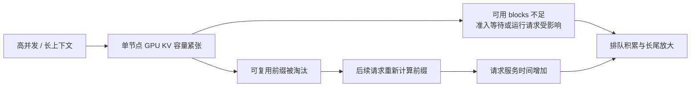

> **待补图 1：Tracing 中的 KV 驱逐与排队放大。**
>
> 由实际运行 tracing 补充。建议标注请求到达、驱逐/抢占事件、等待区间、恢复或重算区间、Prefill 开始和首 token 时间，并注明模型、并发、拓扑及 KV 容量。该位置保留给真实证据，不用示意图代替测量结果。

<!-- tracing-kv-eviction-queue: 在此插入用户提供的 tracing 图。 -->

### 1.2 前缀命中使 Prefill 很快，也让请求成本更不均匀

另一个观察是：正常前缀缓存命中时，实际需要计算的 Prefill 很短，Prefill 执行线上会出现空闲窗口。同样长度的输入，在不同缓存状态下，需要执行的工作量可能相差很大。

前缀命中节省计算是应保留的收益。这里需要改善的是：存在空闲窗口的实例，能否及时承接其他实例上的积压请求，而不因失去前缀命中引入大量重算。应结合多实例 tracing，确认空闲与排队的重叠、持续时间及瓶颈位置。

> **待补图 2：Tracing 中前缀命中后的短 Prefill 与空闲窗口。**
>
> 建议标注输入 token、命中 token、实际 Prefill token、GPU 执行区间和空闲区间；若有其他实例同时排队，可并排展示对应时间线。

<!-- tracing-prefix-hit-prefill-idle: 在此插入用户提供的 tracing 图。 -->

### 1.3 真实负载带前缀复用，Router 难以仅靠路由策略消峰

真实请求通常带有共享前缀、多轮历史或重复上下文。请求成本既受输入长度影响，也受目标节点已有 KV 的影响。Router 因而需要同时考虑缓存命中与队列负载：把请求留在有缓存的节点，可以减少计算；把请求移到较空闲节点，又可能丢失本地命中。

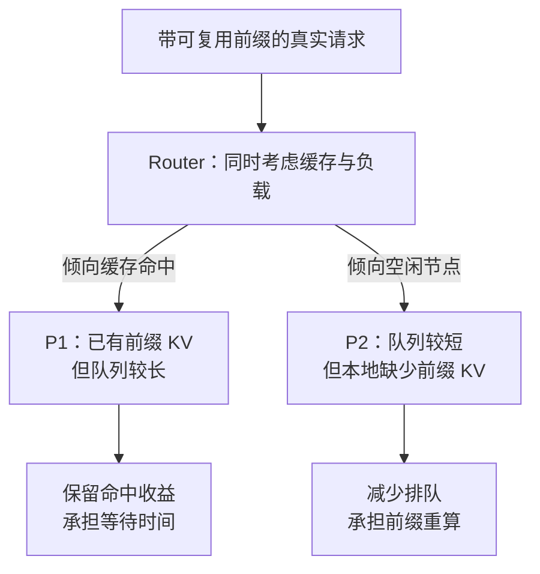

只按请求数均衡，不能反映剩余 Prefill 工作量；过度依赖缓存亲和性，又可能把相关请求集中到少数节点。仅改变 Router 策略，并不会让另一个节点获得已经计算好的 KV。

### 1.4 分布式 KV 为更积极的负载均衡创造条件

希望达到的效果是：计算过的前缀可以在其他实例上恢复，Router 可以在保留前缀复用收益的同时，更积极地把请求分配到等待时间更短的节点。

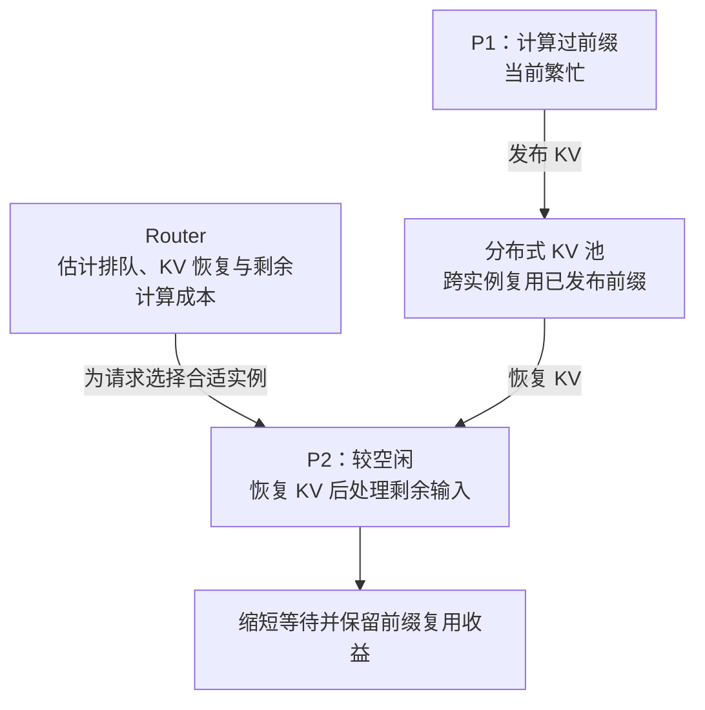

一个简化的路由评估方向是：

```text
候选实例的预计 Prefill 完成成本
    = 预计排队时间 + KV 恢复时间 + 剩余 Prefill 计算时间
```

KV 恢复需要网络、内存带宽和目标 GPU blocks。分布式 KV 扩大的是可复用缓存容量与放置范围，不能直接扩大每个实例运行 Attention 时的 GPU 工作集上限。Router 也仍需遵守 KV 准入、传输带宽和 Decode 侧约束。

本文希望支持的业务目标是：

| 目标 | 需要观察的结果 |
|---|---|
| 缓解 KV 驱逐后的重算与排队 | 重算 token、排队时长、p95/p99 TTFT 改善 |
| 让空闲实例承接有前缀的请求 | 跨实例真实命中，恢复成本低于相应等待或重算成本 |
| 提高可复用 KV 的有效容量 | 固定总资源预算下，命中覆盖率和缓存存活时间提升 |
| 给 Router 更大的调度空间 | 缓存亲和性约束减弱，实例间积压与空闲更均衡 |
| 保持推理正确性和稳定性 | KV/index 恢复正确，取消、失败及重启不破坏后续执行 |

## 2. vLLM、SGLang、LMCache 的相关方案

这里梳理与本问题直接相关的能力。需要先区分三件事：**P/D 点对点传输**把某个请求的 KV 交给另一个执行实例；**分层缓存**把 KV 放到 GPU 之外；**共享对象池**让不同实例按前缀身份查找和复用 KV。同一个底层传输库可以被多种上层方案使用。

### 2.1 vLLM：点对点传输、分层缓存和共享 Store 都有入口

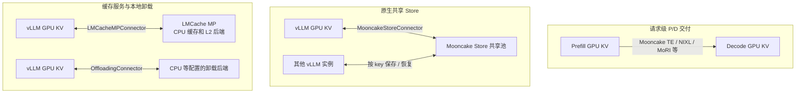

| 入口 | 主要用途 | 对本次选型的意义 |
|---|---|---|
| `MooncakeConnector` | 使用 Mooncake Transfer Engine 做 Prefill/Decode 点对点 KV 交付 | 使用 TE 不代表使用了 Mooncake Store |
| `NixlConnector` 及 Pull/Push 变体、`MoRIIOConnector` | 其他传输实现的请求级 KV 交付 | 可参考传输与完成机制；本身不能等同于共享前缀对象池 |
| `MooncakeStoreConnector` | GPU KV 与分布式 Store 间按对象保存、查找和恢复 | 原生 Store 路线的主要参考实现 |
| `LMCacheConnectorV1` / `LMCacheMPConnector` | 接入 LMCache 的缓存管理能力 | MP 入口对应本文候选方案一 |
| `OffloadingConnector` | 接入 KV 卸载后端 | 本地 CPU 卸载可扩容；跨实例共享仍取决于具体后端 |
| `MultiConnector` | 组合不同 connector | 组合能力与子 connector 的缓存协议、完成协定需要分别适配 |

本地 vLLM Store worker 使用 GPU buffer 注册以及 `batch_put_from_multi_buffers` / `batch_get_into_multi_buffers`，并包含 PP/TP/DCP 分片 key 的查询逻辑。它可作为同构布局的参考；异构 Store TP 的支持范围受模型和布局限制，不能扩展解释为任意 PP/DCP 拓扑都能互读。

依据：[connector 注册表][vllm-factory]、[Mooncake 点对点实现][vllm-pd]、[Store worker][vllm-store-worker]、[Store 使用说明][vllm-store-guide]。

### 2.2 SGLang：HiCache 分层共享与可选 GPU 直接访问

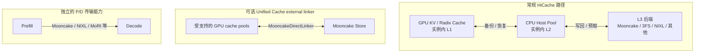

常规 HiCache 将 GPU、CPU Host Pool、外部存储组织为多个层级。CPU Host Pool 通常属于本实例；只有外部后端按共享方式部署时，其他实例才可以通过该后端复用 KV。Mooncake 是其中一种后端，不能把 SGLang 的所有缓存或 P/D 传输都归为 Mooncake Store。

当前本地版本还存在 `MooncakeDirectLinker`：通过 Unified Cache 的 external linker 接入，注册 device pool，并支持按层从 Store 恢复到 GPU、异步保存。这说明 SGLang 也在提供更直接的 GPU↔Store 路径；它的适用范围由统一缓存入口、pool 适配及 SDK 能力决定，不能把该路径当成所有 HiCache 配置的默认行为。

对 ATOM 的启发是：CPU 中间层的缓存策略有独立价值；GPU 直接访问 Store 也是一条成立的路线。需要根据工作负载决定是否需要这一层 CPU 热缓存。

依据：[HiCache 设计][sg-hicache-design]、[HiRadixCache][sg-hiradix]、[存储后端工厂][sg-storage-factory]、[Mooncake 后端][sg-store]、[external linker 入口][sg-registry]、[MooncakeDirectLinker][sg-direct]、[P/D 后端选择][sg-pd]。

### 2.3 LMCache：MP CPU 缓存、共享 L2 和 P2P

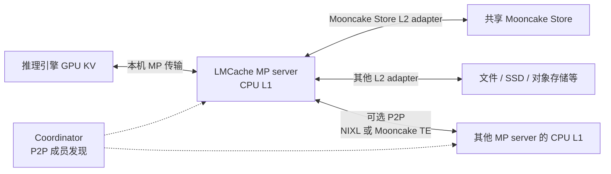

层级名称按各项目自身定义使用：SGLang HiCache 的 L1 是 GPU、L2 是 CPU；LMCache MP 的 L1 是 CPU、L2 是外部后端。比较时应看物理数据路径和缓存职责。

与本问题最相关的三类能力是：

| 能力 | KV 从哪里恢复 | 依赖的管理机制 |
|---|---|---|
| 本机 CPU L1 | 本机 MP server 已缓存的 KV | MP 的缓存、锁和淘汰管理 |
| Mooncake Store L2 | 已发布到共享 Store 的对象 | Mooncake Master 和 Store owner |
| P2P | 其他 MP server 仍持有的 CPU L1 KV | Coordinator 发现成员，peer 查询/锁定与传输通道 |

P2P 可复用源节点已有的 CPU L1，省掉先发布到 Store 的步骤，但受源节点生命周期、容量和热点读取压力影响。P2P 的 `mooncake_te` 使用的是 Transfer Engine；它与 Mooncake Store L2 是不同机制。默认 peer 选择策略也不能视为已经具备按延迟或负载的最优选源。

本文候选方案一采用 **MP + Mooncake Store L2**。P2P 和多后端是 LMCache 的扩展能力，其收益不计入 MP + Store 的同条件比较。

依据：[MP Store L2 adapter][lm-l2]、[Store L2 配置][lm-l2-guide]、[P2P 文档][lm-p2p]、[P2P controller][lm-p2p-controller]、[prefetch policy][lm-prefetch]。

## 3. 两条候选路线与共同的 Store 基础

### 3.1 选型范围

综合现有实现与 ATOM 的接入基础，本文将讨论集中到两条路线：

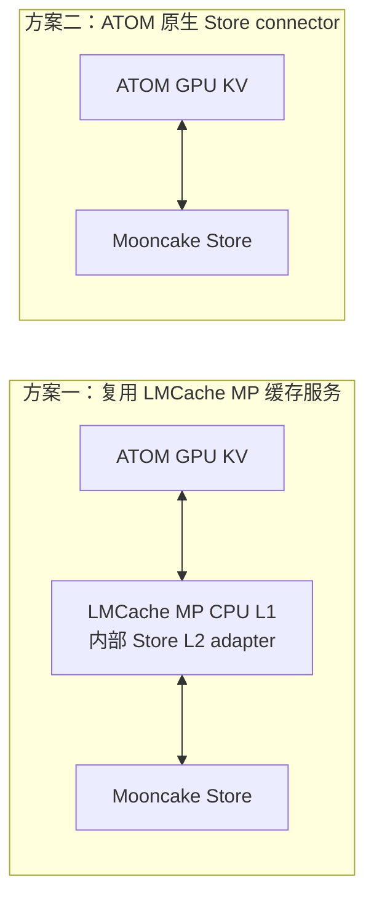

两者都使用 Mooncake Store 管理共享对象。核心差异在于：ATOM 通过 MP 缓存服务访问 Store，还是由 ATOM worker 的原生 connector 直接访问 Store。

统一部署采用选定的一条路线。接入范围覆盖 **TP、PP/CPP、DCP Prefill 和 DCP Decode**；PP 沿用同一个 head 的统一调度与 page table。对比先采用相同模型、同构布局、同一 Store 介质和容量、相同 owner 放置及网络条件。

### 3.2 多机 CPU 内存如何组成 Store

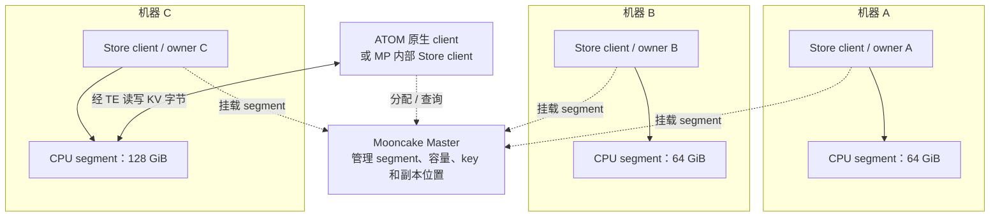

各 owner 在本机申请内存，再挂到同一个 Master 下。上图组成 `64 + 64 + 128 = 256 GiB` 原始容量的共享池；实际数据仍分布在各机器的 segment 内。图中访问 C 只是一个例子，目标位置由放置策略决定，也可以是本机 segment。

Master 管理元数据，KV 数据由 Transfer Engine 在客户端与 owner 之间传输。owner 可以与推理共机，也可以在独立机器；同机时可以内嵌在已有进程，也可以独立运行。

单副本时，一个对象通常只占一份 Store 空间。若所有对象使用两个等大的内存副本，256 GiB 的池至多容纳约 128 GiB 有效数据，还要扣除分配开销。共享池不要求每台机器都保存同一份 KV。

### 3.3 三类内存不能混为一谈

| 内存 | 谁管理 | 作用 |
|---|---|---|
| ATOM GPU KV page 池 | ATOM 引擎 | Attention 实际使用的 KV，保存源与恢复目标 |
| MP CPU L1 | LMCache MP，仅方案一存在 | 本地热缓存、D2H/H2D 中间层与远端上传缓冲 |
| Store segment | Mooncake owner | 向整个集群提供对象存储容量 |

SDK 的本地工作 buffer 还需单独预算。普通 PUT 将 KV 放到已经预留的 segment 内部，占用其中一部分空间；不会在 segment 之外再额外分配一份同样的 Store 容量。

### 3.4 内存申请、注册与对象发布

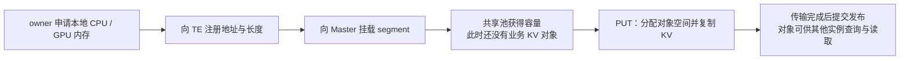

ATOM 或 MP 还会注册自己的 I/O buffer。**注册地址不会复制业务 KV，也不会自动发布前缀 key。** ATOM 的 page 编号、layer/head/token 布局由引擎及 adapter/connector 解释；Master 管理的是对象身份、大小、位置和副本。

源码中的关键链路为 `RealClient` 分配内存、`registerLocalMemory` 注册、`MountSegment` 挂载，再由 `PutStart`、数据传输、`PutEnd` 完成对象写入。依据：[RealClient][mc-real]、[Store Client][mc-client]。

### 3.5 GPU 作为 Store 介质时的区别

GPU Store 仍采用本地申请和统一挂载的方式。一个容易控制设备与容量的部署方式是一张 GPU 对应一个 owner，分别贡献专用 VRAM。

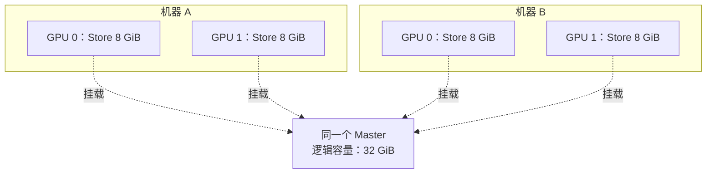

这些 GPU 显存组成按 key 访问的逻辑共享池，并不会变成一根跨机 CUDA 指针。如果与推理共用 GPU，需要同时计算：

```text
GPU 显存预算
    = 模型权重 + 运行时工作区 + ATOM KV page 池
      + Store VRAM segment + 其他运行开销
```

Store VRAM 是独立预留空间，普通 PUT 仍会形成独立的 Store 拷贝。直接让现有 ATOM GPU pages 长期充当可读对象，还需要地址稳定性、远端读者和页回收协同设计，注册内存本身不能提供这些保证。

当前 Mooncake 的 `USE_VRAM_SEGMENT` 会启用 CUDA，分配代码使用 `cudaGetDevice` / `cudaMalloc`；RDMA NUMA 分段和大页分支还可能分配主机内存。**客户端 GPU 直传与 Store 本身使用 VRAM 是两个不同的能力。** ATOM/ROCm 的 VRAM Store 仍需落实 HIP 分配、释放、内存类型识别和 GPU RDMA 验证；本文两方案比较以 CPU DRAM Store 为基线。

依据：[构建选项][mc-build]、[VRAM 分配][mc-alloc]、[实际 segment 分配分支][mc-real]。

## 4. 方案一：LMCache MP + Mooncake Store

### 4.1 架构与职责

ATOM 对接本机 LMCache MP server。MP 管理 CPU L1，通过其内部的 Mooncake Store L2 adapter 访问共享池。“内部”指 Store SDK/L2 适配逻辑运行在 MP 这一层；Master 和实际 Store 容量仍按共同的集群方式管理。

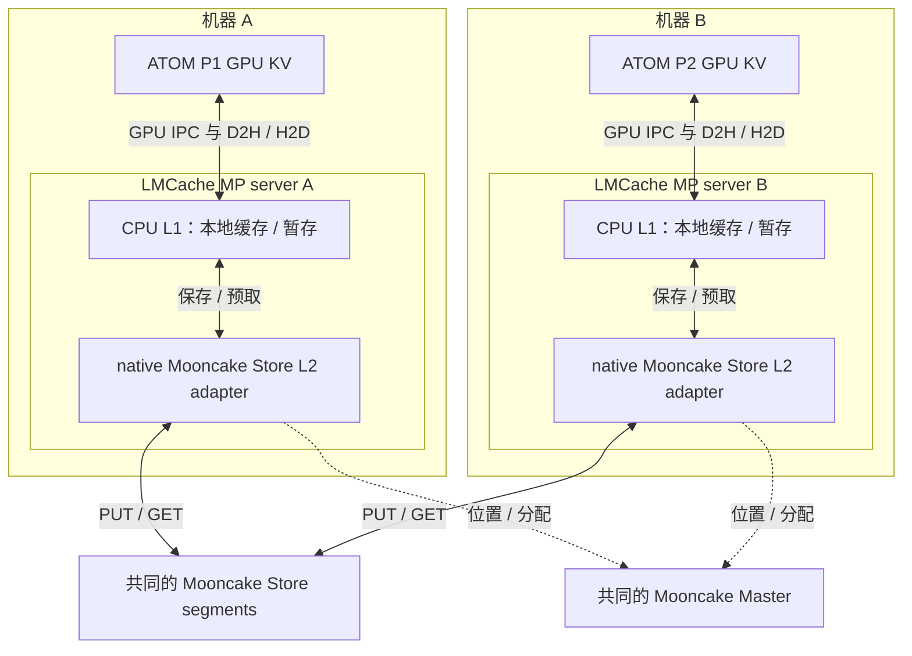

控制消息用于注册、任务和完成通知，KV 数据通过已注册的内存与设备传输路径移动。MP 不要求把整份 GPU KV 序列化到消息队列里。

| 组件 | 主要职责 |
|---|---|
| ATOM head / scheduler | 选择保存/恢复范围，管理请求、目标 blocks 和跨 rank 完成 |
| ATOM MP adapter | 提供 KV tensor view、布局身份、block 列表、注册和设备完成处理 |
| LMCache MP server | 操作已注册的 GPU KV、管理 CPU L1、执行 D2H/H2D、缓存与存储策略 |
| MP 内部 Store L2 adapter | 从 CPU L1 对象调用 Mooncake 的查找、PUT、GET |
| Mooncake Store | 对象空间分配、分布式放置、共享容量、淘汰和副本管理 |

依据：[ATOM MP adapter][atom-mp]、[LMCache 传输模块][lm-transfer]、[Store L2 adapter][lm-l2]。

### 4.2 保存：先结束 GPU 读取，再从 CPU 发布到 Store

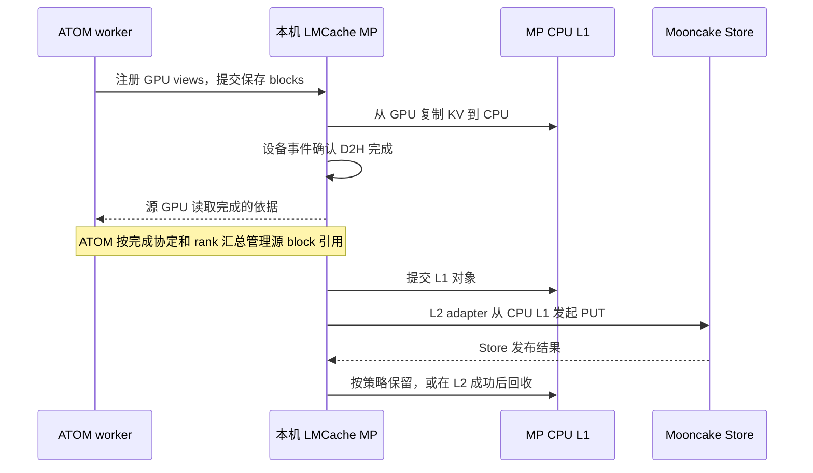

这里有三个不同的状态：源 GPU 可以结束被读取、L1 对象已提交、共享 Store 对象已经发布。D2H 完成不能直接宣称另一台机器已经能从 Store 命中。

这条路径的价值是：当远端写入较慢，KV 可以先留在 CPU L1 中继续上传，减少网络尾延迟对源 GPU blocks 的占用。但 L1 缓冲受容量限制，仍需队列、流控和失败清理。

依据：[设备传输与事件][lm-transfer]、[StorageManager.finish_write][lm-storage-manager]、[StoreController][lm-store-controller]。

### 4.3 恢复：本机 L1 命中，或从 Store 预取后 H2D

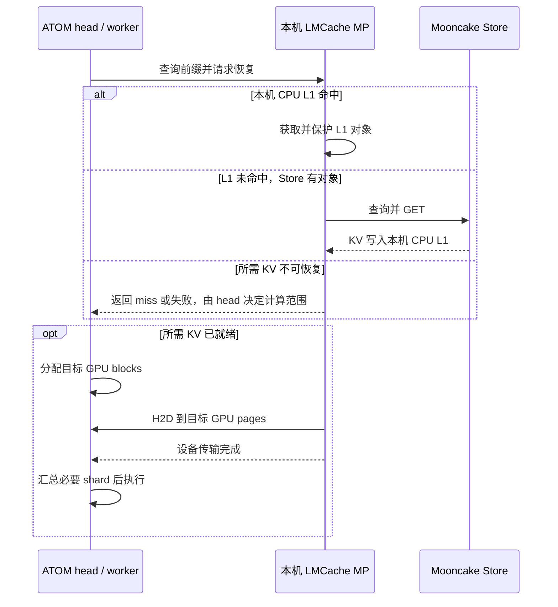

远端真实命中的基本数据路径是 `Store → MP CPU L1 → GPU`。本机 L1 命中可以省掉 Store GET 和远端读取，这是独立 CPU 热缓存的主要价值。

现有 ATOM `_MPLookupClient` 使用同步轮询，server 具备异步能力不等于 scheduler 已经具备非阻塞 lookup。是否等待预取、等待多久、何时回退，需要与 ATOM 调度策略共同设计。

### 4.4 CPU L1 与 Store 内存的容量和策略

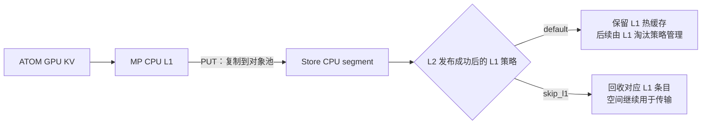

默认策略不会在 L2 PUT 成功后主动删除 L1，所以一份 KV 可以同时存在于 MP L1 和 Store。`skip_l1` 在成功写入 L2 后删除相应 L1 条目，减少长期重复占用；它仍需要上传期间的 L1 容量，也没有绕过 D2H/H2D。读取后的缓存保留由 prefetch policy 等机制管理，需要分别配置。

例如一个节点配置 32 GiB MP L1，并由本进程另贡献 64 GiB Store segment，两者合计预留 96 GiB CPU 容量，还未计 SDK 和其他开销。若 Store owner 在外部，MP 可不贡献 segment，但本机 L1 仍存在。

依据：[default / skip_l1 策略][lm-store-policy]、[prefetch policy][lm-prefetch]。

### 4.5 使用复杂度与当前基础

这条路线已有 ATOM adapter、MP 服务和 native Store L2 adapter，因此在已有 TP/PAGE 场景上，复用现成能力的起点较高。对于完整目标，仍需要区分已有功能和接入缺口。

| 项目 | 当前基础或配置责任 |
|---|---|
| ATOM 入口 | 已有 `lmcache_mp`，提供 GPU 注册、保存/恢复和完成处理基础 |
| GPU 传输模式 | 当前 ATOM 要求 `lmcache_driven` 路径，明确拒绝 `engine_driven` |
| MP server | 部署可访问本机 GPU 的服务，设置 L1、chunk、淘汰与保存策略 |
| Store L2 | 使用 `type: mooncake_store`；配置 Master、网络和贡献容量 |
| native 构建 | `lmcache_mooncake` 扩展需要显式构建，RDMA 还要求有效 L1 内存描述符 |
| 容量 | L1、Store segment、SDK buffer 分别预算 |
| 并行覆盖 | 当前 ATOM adapter 拒绝 PP、DCP、PCP，并且只接受一个 server 地址；需要扩展 |

这意味着“更容易先做 TP 验证”有代码依据；完整覆盖 PP/CPP 和 DCP 的工程量，需要在接入设计后评估。MP 的本机 GPU IPC 也不能靠一个跨主机 server 地址替代。

## 5. 方案二：ATOM 原生 Mooncake Store

### 5.1 架构与职责

在 ATOM worker 内实现 Store connector，参考 vLLM 的对象查询、地址规划、批量传输和完成模型。对于可直接传输的布局，以 GPU buffer 作为 PUT 源和 GET 目标。

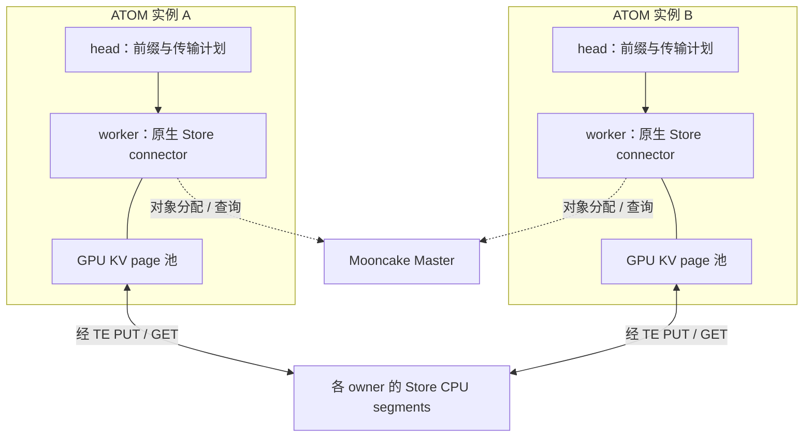

| 组件 | 主要职责 |
|---|---|
| ATOM head / scheduler | 前缀身份、必要 shard、异步查找、目标 blocks、完整性与回退 |
| worker / layout codec | 注册 GPU buffer、生成地址和长度列表、处理辅助 index 与布局转换 |
| Store connector | 管理 client、提交 PUT/GET、跟踪任务与设备完成、回报结果 |
| Mooncake Store | 管理共享对象及其存储和传输 |

Store 可以使用本机 CPU segment，也可以访问独立 owner。直接 GPU↔Store 的路径不要求 Store 介质为 GPU，也不要求 Store 位于独立机器。

### 5.2 初始化与数据注册

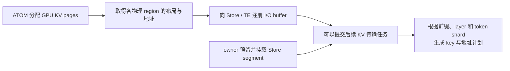

引擎 page 池和 Store segment 独立管理。GPU buffer 注册只说明该地址可用于传输；对象 key、内容与生命周期仍由后续保存任务建立。

不连续 region、辅助 index 或异构转换可能需要 pack/scatter、临时缓冲和额外设备同步。直接 byte API 不能自动解释所有 ATOM 模型状态。

依据：[vLLM register_kv_caches 与传输调用][vllm-store-worker]、[StoreLayout][vllm-store-layout]。

### 5.3 保存与恢复的完整时序

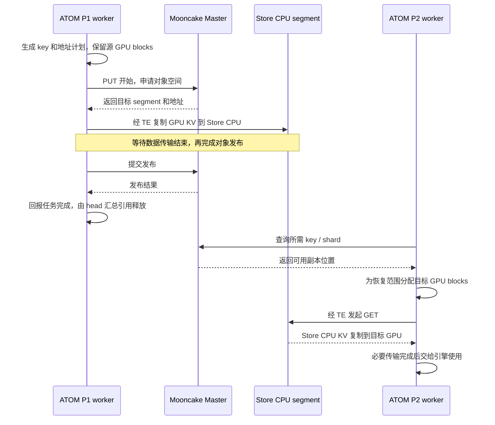

上图按一个对象展开，省略批量与失败路径。单对象完成不代表整个 PP/DCP 前缀完整，head 还需要汇总必要 shard。

### 5.4 GPU blocks 的保留与回收

异步 PUT 在读取源 GPU 地址期间，ATOM 必须阻止相应 blocks 被回收或覆盖。vLLM 为保存任务增加 block 引用，并在必要 worker 完成后释放；当前部分路径会保留请求的全部相关 blocks，以支持后续补写。ATOM 应借鉴其正确性约束，再根据自身调度决定引用粒度。

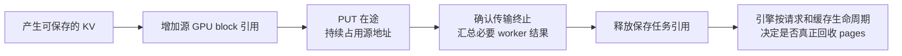

当网络或 Store 较慢时，源 GPU blocks 可能被保留更久。这条路线需要保存队列上限、在途字节预算和 HBM 引用预算，防止保存任务加重原本的 GPU KV 容量瓶颈。

依据：[vLLM Store scheduler][vllm-store-scheduler]。取消或 RPC 超时不能直接视为设备传输已经终止。

### 5.5 KV 拷贝数量与数据寿命

以 1 GiB KV、Store 单副本、无需额外暂存为例：

| 时刻 | P1 GPU KV | Store CPU | P2 GPU KV |
|---|---|---|---|
| P1 已生成，尚未 PUT | 1 GiB | 无此对象 | 无 |
| PUT 成功，P1 pages 仍保留 | 1 GiB | 1 GiB | 无 |
| P2 GET 完成，P1 pages 仍保留 | 1 GiB | 1 GiB | 1 GiB |
| P1 pages 已回收 | 无 | 1 GiB | 按 P2 生命周期保留 |

GET 是读取和复制，正常 GET 不删除 Store 对象。P1 pages 回收后，已发布的 Store 对象仍可使用；Store 对象被淘汰后，P2 已恢复的 GPU KV 也由 P2 继续管理。

若 PUT 和 GET 都跨机，两次单副本传输合计约 2 GiB 数据负载，未计协议、重试和辅助数据。若某一阶段访问本机 Store segment，相应复制不能全部计作网络流量。

### 5.6 使用复杂度与当前基础

| 项目 | 当前基础或配置责任 |
|---|---|
| ATOM 入口 | 需要实现新的 scheduler/worker Store connector |
| 可复用部分 | ATOM 的 KV regions、PP head、完成汇总，以及 vLLM 的 Store 地址规划与引用模型 |
| Store client | 在 worker 中管理 SDK、内存注册、任务、错误与资源清理 |
| Store owner | 可内嵌贡献内存，也可由独立进程提供；按部署目标选择 |
| CPU 路径 | 无独立 MP L1；Store segment 和必要 SDK/转换缓冲仍占资源 |
| GPU/RDMA | 必须验证 ROCm 上的实际注册与传输路径，不能只凭 API 存在判断可用 |
| 并行覆盖 | 从设计阶段覆盖 PP/CPP 与 DCP；参考实现仍需按 ATOM 布局适配 |

该路线把缓存服务层做得更集中于共享 Store，同时让 ATOM 承担更多引擎侧协议与客户端生命周期工作。

## 6. 方案对比与取舍

### 6.1 两条路线改变的是数据路径和责任分配

| 比较项 | 方案一：LMCache MP + Store | 方案二：ATOM 原生 Store |
|---|---|---|
| 远端恢复路径 | Store → MP CPU L1 → GPU | 适合的布局上 Store → GPU |
| GPU 保存源的释放 | D2H 完成后可结束源读取，远端 PUT 从 CPU 继续 | 直接 PUT 读取 GPU，需保留源 blocks 到传输终止 |
| 本地热点缓存 | 有独立 CPU L1 与缓存策略 | 可命中本机 Store segment，局部性由放置/读取策略决定 |
| CPU 容量效率 | 默认可能同时保留 L1 和 Store 拷贝；可用策略调整 | 不需要 MP L1；仍有 Store 及必要缓冲 |
| GPU KV 容量压力 | CPU 缓冲有机会缩短网络尾延迟造成的源引用保留 | 在途保存可能延长 GPU block 占用，需要显式预算 |
| 零散布局 | 可以先聚合为 CPU 对象，聚合也有成本 | 可多 buffer 直传；碎片过多会增加描述符与调度开销 |
| 引擎接入起点 | 有当前 TP/PAGE adapter，可复用缓存服务 | 需要新 connector，可参考 vLLM 与 ATOM 已有机制 |
| PP/DCP 全覆盖 | 扩展当前硬限制、注册身份和跨 server 完成 | 设计原生 shard 协议、地址计划和完成汇总 |
| 服务与构建 | MP server、GPU IPC、LMCache native Store 扩展及 Mooncake | Store bindings/client、GPU 注册、owner 和 Mooncake |
| 功能扩展 | 已有多 L2、P2P 与缓存策略框架 | 聚焦 Store，额外引擎策略由 ATOM 维护 |
| 故障影响 | 需处理 MP/L1 生命周期与 Store 失败 | 需处理 worker 内 client、在途 GPU 引用和 Store 失败 |
| Router 集成 | 需要向路由层提供缓存/恢复/负载信息 | 同样需要 Router 侧协同，connector 本身不改变路由 |

两者都能访问相同的共享 Store，不能把“用了共享池”的总体收益当成某一条路线独有。性能还受缓存策略、NUMA、NIC 放置、恢复范围和 I/O 重叠影响。

### 6.2 关键取舍：CPU 缓冲还是 GPU 在途引用

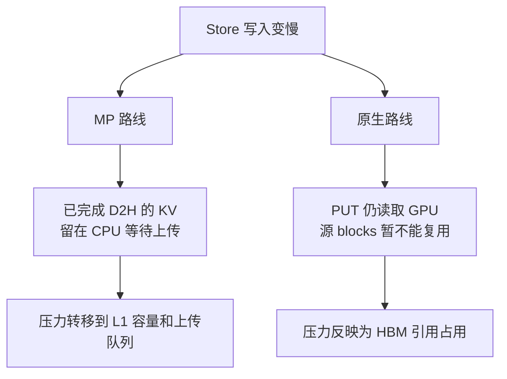

对于本次 KV 容量瓶颈，不能只比较传输次数。MP 多一层 CPU 路径，但可能更早结束源 GPU 读取；原生路径减少中间层，但保存任务可能占住 HBM。应同时测量 CPU 占用、GPU 引用字节与持续时间，以及它们对准入和 TTFT 的影响。

### 6.3 选型应由哪些条件驱动

| 如果验证表明…… | 更有吸引力的方向 | 仍需确认 |
|---|---|---|
| 本机 CPU 热缓存有明显收益，远端上传背压突出 | MP + Store | 固定总 CPU 预算下，L1 是否挤占过多共享容量 |
| 大多数收益来自跨实例 Store，CPU L1 命中收益有限 | 原生 Store | GPU 引用预算和直接恢复路径能否稳定控制尾延迟 |
| 希望较早复用现成 TP 能力进行试验 | MP + Store | 完整 PP/DCP 接入和运行维护成本 |
| 希望由 ATOM 统一掌握布局与异步调度 | 原生 Store | connector、失败处理和 SDK 升级的长期维护责任 |

目前没有同条件 GPU/RDMA 基准可以给出性能排名。选择标准应回到背景中的排队、前缀复用和 Router 调度空间，而不只看组件数量或已有 adapter 的存在。

## 7. ATOM 接入工作与并行覆盖

### 7.1 两条路线共同复用 head

现有 PP 由 head 统一调度并下发 page table。各 stage 不需要独立建立前缀调度器；它们执行同一请求中自己负责的 layer/token shard。

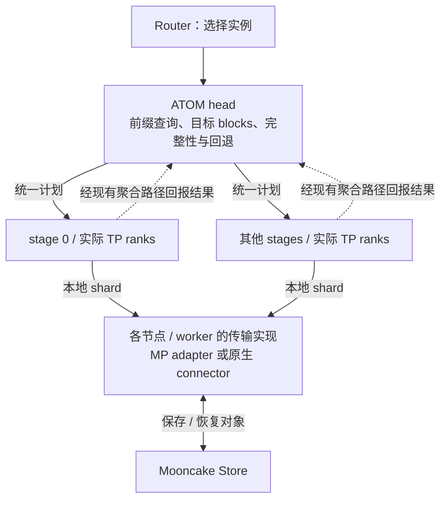

同一 head 的调度身份一致，但不同 shard 的写入与淘汰可能分别发生。恢复前缀需要检查全部必要 shard；GPU pages 的释放或复用也必须遵守相关传输的完成状态。

依据：[PP engine][atom-pp]、[现有 Mooncake PP 路径][atom-pd]、[PPKVOutputAggregator][atom-aggregator]。

### 7.2 PP/CPP 与 DCP 的具体工作

这里的 CPP 指 chunked pipeline parallelism（分块流水线并行）。两条路线都保留现有 head 的统一调度，在该调度边界内增加 KV 查询、传输和完成处理。

| 范围 | 共同要求 | MP 路线的重点 | 原生路线的重点 |
|---|---|---|---|
| TP / PAGE | chunk 与 block 几何一致，KV/index 完整 | 复用现有 tensor views、GPU IPC 与事件 | 生成直接 PUT/GET 的 region 地址计划 |
| PP / CPP | head 统一前缀和 page table，stage 负责自己的层 | 增加 stage/rank 注册身份，按本机 GPU 放置 server，汇总多个服务 | 在对象身份中表达绝对层范围，聚合 stage 传输任务 |
| DCP Prefill | 表达 rank-local token 分片及辅助 index | 扩展当前拒绝 DCP 的 adapter，修正 chunk/block 映射 | 按 rank-local region 生成 key 与地址列表 |
| DCP Decode | 恢复后 Decode 正确；新增 KV 可按明确边界发布 | 扩展保存范围及 accepted/computed frontier 协定 | 参考 `save_decode_cache`，在 ATOM 定义写回边界 |
| DCP P→DCP D | 共享缓存与请求级 P→D 交付协同验证 | MP 不自动解决 PD 的拓扑映射 | Store 也不自动改变已有 PD 映射限制 |
| 不同拓扑互读 | 需要真实布局转换与完整性定义 | 设计 CPU 对象表示或重排机制 | 设计传输 codec / pack-scatter 机制 |

ATOM DCP 的 token owner 规则为：

```text
owner = (global_token // interleave) % dcp_size
```

DCP 使用 TP ranks，不能重复计为 `PP × TP × DCP` 个 worker。scheduler block 对应的全局 token 范围与单 rank 的物理 page 几何需要明确区分。

同构部署可以先保存 rank-local 表示。已有 ATOM PD 路径在 producer DCP>1 且两端 DCP size 不同时有显式限制；non-DCP→DCP 的既有映射也有布局条件。这些边界需要共同验证，不能仅通过更换对象 key 或 Store 地址绕过。

依据：[DCP 布局][atom-dcp]、[ATOM MP 校验和注册][atom-mp]、[当前 PD 传输][atom-pd]、[vLLM Store 布局限制][vllm-store-guide]。

### 7.3 接入任务清单

| 工程项 | 共同行为与交付物 | MP 特有工作 | 原生特有工作 |
|---|---|---|---|
| 模型与布局身份 | key 包含前缀、模型/编码版本、层范围、必要 TP/DCP 信息 | 扩展 MP namespace 和注册协议 | 实现对象 key 与 layout codec |
| 查找与预取 | 查询必要 shard；有等待预算，不阻塞正常调度 | 改造当前同步轮询入口与 server 预取协定 | 实现异步 lookup/pending/retry |
| 保存与恢复 | chunk 边界、辅助 index、设备同步和结果校验 | 扩展 MP tensor/group 描述 | 实现 batch buffer 计划与必要转换 |
| 完成与引用 | 区分源读取结束、对象发布、全前缀可恢复 | 对接 device future、L1 提交和 L2 发布状态 | Store job 身份、GPU block 引用和全 rank 汇总 |
| 流控 | 在途字节、队列上限、超时和回退规则 | L1 空间与远端上传积压 | HBM 保存引用与直接传输积压 |
| 生命周期 | 重启、重注册、取消、关闭和故障清理 | 本机服务连接、GPU IPC 和跨 stage/server 汇总 | worker client、buffer 注销和传输结束 |
| 构建与镜像 | 固定 Mooncake 版本，确认 Store 与 RDMA 产物 | LMCache native 扩展及 GPU 平台支持 | Mooncake Store bindings 与引擎依赖 |
| 可观测性 | 关联 request、prefix、shard、transfer job 与 tracing | 追加 L1 命中、D2H/H2D 和 L2 积压 | 追加直接 PUT/GET 和 GPU 引用持续时间 |
| Router 信息 | 定义队列、KV 容量、可恢复前缀与恢复成本的观测方式 | 从 MP/ATOM 汇总状态 | 从 connector/ATOM 汇总状态 |

当前 ATOM release Dockerfile 的 Mooncake 构建关闭了 `WITH_STORE`。两条使用 Store 的路线都需要检查和调整实际镜像产物，已经具备 TE 不代表已经具备 Store。依据：[release Dockerfile][atom-docker]、[MP Store native 构建说明][lm-l2-guide]。

### 7.4 必须具备的失败语义

| 情况 | 必须保证的行为 |
|---|---|
| 某段数据传输尚未终止 | 保留该传输实际读取的源 buffer；MP 远端 PUT 的源为 CPU L1，原生直传的源为 GPU regions |
| L1 成功但 Store 尚未发布 | 不把它宣称为其他节点已经可读的共享对象 |
| 只保存或恢复了部分 shard | 不将缺少必要分片的范围计为完整命中 |
| lookup 命中后 GET 失败 | 等待目标写入终止，再回退重算或复用 blocks |
| 请求取消或超时 | 超时不代表 DMA 停止；避免迟到写覆盖新请求 |
| owner 退出或对象淘汰 | 使用可用副本或按 miss 处理，不假设内存对象永久存在 |
| 正常关闭/重新注册 | 在相关传输结束后注销或释放 buffer |

### 7.5 建议的验证顺序

```mermaid
flowchart LR
    Contract["确定对象、布局和完成协定<br/>覆盖全部目标拓扑"] --> TP["TP 场景验证保存 / 跨实例恢复"]
    TP --> PP["PP/CPP<br/>head 与 stage 完整性"]
    PP --> DCP["DCP Prefill + Decode<br/>token shard、index、写回"]
    DCP --> Fault["并发、拥塞、取消和重启"]
    Fault --> Router["真实前缀负载<br/>Router 调度收益对比"]
```

顺序用于逐层定位问题，最终范围仍包含两类 Prefill 部署以及 DCP Prefill/Decode。异构布局互读的范围需要另外明确，不能将同构共享成功作为其验收结果。

## 8. 验证计划与讨论议题

### 8.1 先用 tracing 建立问题基线

补齐第一章两张 tracing 图，记录模型、并发、请求到达轨迹、前缀复用分布、GPU KV 容量和 Router 策略。将 TTFT 拆成排队、缓存查找/恢复、实际 Prefill 和后续交付等阶段，确认目标改善发生在哪一段。

复用相同的真实请求序列评估，明确区分冷缓存、预热阶段和稳定命中阶段。缓存命中率应同时记录本地 GPU、本地 CPU 和远端 Store，避免把本地命中当作跨实例共享收益。

### 8.2 公平比较的资源口径

| 比较口径 | 固定什么 | 观察什么 |
|---|---|---|
| 路径差异 | 相同 Store 容量、owner 位置、网络、模型和布局 | 直接恢复与 CPU 中间层的开销和重叠能力 |
| 部署效率 | 相同总 CPU 内存：MP L1 + Store + 必要缓冲 | 有效缓存容量、重复拷贝与真实命中收益 |
| HBM 压力 | 相同推理 GPU 预算与并发轨迹 | 保存引用导致的容量占用、准入和排队 |
| Router 收益 | 相同到达序列，对比固定的路由策略组合 | 等待、恢复、重算之间的净收益 |

两条路线都应设置合理预算，不把无限 CPU 缓冲或无限 GPU block 保留作为默认条件。MP P2P 若需要测量，应另设实验，避免混入 MP + Store 的结果。

### 8.3 必测场景与指标

| 场景 | 验证重点 |
|---|---|
| P1 发布后，P2 首次遇到相同前缀 | 远端真实命中、恢复 token、KV/index 与输出正确性 |
| 某节点前缀淘汰后再次访问 | 从 Store 恢复的比例、重算 token、排队与 TTFT |
| 热点前缀、实例间负载倾斜 | 空闲节点承接能力、网络热点、Router 净收益 |
| 高命中、短实际 Prefill | CPU H2D/恢复是否成为主导，Prefill 空闲是否改善 |
| GPU 紧张，Store 写入受限 | L1 积压、GPU 引用字节与持续时间、准入停顿 |
| 长前缀与零散 KV/index 布局 | pack/scatter、RDMA 描述符和计算/I/O 重叠 |
| PP/CPP、DCP Prefill、DCP Decode | 全 shard 完成、chunk 边界、Decode ITL 与新增 KV 写回 |
| 单 shard 缺失、取消、MP/owner 重启 | 正确回退，无提前回收、迟到写或缓存锁泄漏 |

### 8.4 后续讨论需要形成的决定

| 议题 | 需要确定的内容 |
|---|---|
| 优先优化目标 | 排队长尾、总吞吐、命中覆盖率、资源成本的优先级 |
| 是否长期需要本地 CPU 热缓存 | 其命中收益是否覆盖重复容量与中间传输成本 |
| owner 放置 | 共机贡献、独立进程或专用节点；对应 NUMA/NIC 与生命周期 |
| KV 对象粒度 | chunk/page、layer/token shard、辅助 index 与版本化方式 |
| 副本与容量 | 单副本或多副本、预算、淘汰及热点策略 |
| 保存策略 | 保存范围、触发时机、Decode 新增 KV、在途预算 |
| Router 协同 | 可恢复前缀信息如何暴露，是否采用队列与恢复成本估计 |
| 异构互读范围 | 是否需要不同 TP/PP/DCP 拓扑，以及转换成本是否值得 |
| 选型验收 | 两条路线在同一资源和工作负载口径下的通过条件 |

当前文档提供技术选项和判断依据；在 tracing 证据、接入设计与同条件验证补齐后，再决定采用哪条路线及其参数。

## 9. 源码依据

本文能力描述基于以下本地代码快照；源码存在、镜像中可用和多机验证通过是三个不同的状态。当前未执行本方案的 GPU/RDMA 基准或故障注入，背景中的 tracing 图由实际运行材料补充。

| 仓库 | 代码快照 | 主要核对内容 |
|---|---|---|
| ATOM | `90b011ca8dd1` | MP adapter、PP head、DCP 布局、PD 传输、镜像构建 |
| vLLM | `f92b78f6ef9c` | connector 入口、Mooncake TE、原生 Store、布局与 block 引用 |
| SGLang | `d00adfd19cb6` | P/D 后端、HiCache、Mooncake Store、可选 direct linker |
| LMCache | `80acf90b1613` | MP 传输、L1/L2、Store adapter、缓存策略与 P2P |
| Mooncake | `78566d459c14` | segment 分配、内存注册、对象发布、CPU/VRAM 路径 |

[atom-mp]: ../atom/kv_transfer/offload/mp/backend.py
[atom-pp]: ../atom/model_engine/pp_engine_core.py
[atom-pd]: ../atom/kv_transfer/disaggregation/mooncake/mooncake_connector.py
[atom-aggregator]: ../atom/kv_transfer/disaggregation/pp_kv_aggregator.py
[atom-dcp]: ../atom/distributed/dcp_layout.py
[atom-docker]: ../docker/atom_release.dockerfile
[vllm-factory]: https://github.com/vllm-project/vllm/blob/f92b78f6ef9c9b28f60668da77af5b65645b1a45/vllm/distributed/kv_transfer/kv_connector/factory.py
[vllm-pd]: https://github.com/vllm-project/vllm/blob/f92b78f6ef9c9b28f60668da77af5b65645b1a45/vllm/distributed/kv_transfer/kv_connector/v1/mooncake/mooncake_connector.py
[vllm-store-worker]: https://github.com/vllm-project/vllm/blob/f92b78f6ef9c9b28f60668da77af5b65645b1a45/vllm/distributed/kv_transfer/kv_connector/v1/mooncake/store/worker.py
[vllm-store-layout]: https://github.com/vllm-project/vllm/blob/f92b78f6ef9c9b28f60668da77af5b65645b1a45/vllm/distributed/kv_transfer/kv_connector/v1/mooncake/store/data.py
[vllm-store-scheduler]: https://github.com/vllm-project/vllm/blob/f92b78f6ef9c9b28f60668da77af5b65645b1a45/vllm/distributed/kv_transfer/kv_connector/v1/mooncake/store/scheduler.py
[vllm-store-guide]: https://github.com/vllm-project/vllm/blob/f92b78f6ef9c9b28f60668da77af5b65645b1a45/docs/features/mooncake_store_connector_usage.md
[sg-hicache-design]: https://github.com/sgl-project/sglang/blob/d00adfd19cb6ea56de2f2fe814924f0c9a1664f8/docs/docs/advanced_features/hicache_design.mdx
[sg-hiradix]: https://github.com/sgl-project/sglang/blob/d00adfd19cb6ea56de2f2fe814924f0c9a1664f8/python/sglang/srt/mem_cache/hiradix_cache.py
[sg-storage-factory]: https://github.com/sgl-project/sglang/blob/d00adfd19cb6ea56de2f2fe814924f0c9a1664f8/python/sglang/srt/mem_cache/storage/backend_factory.py
[sg-store]: https://github.com/sgl-project/sglang/blob/d00adfd19cb6ea56de2f2fe814924f0c9a1664f8/python/sglang/srt/mem_cache/storage/mooncake_store/mooncake_store.py
[sg-registry]: https://github.com/sgl-project/sglang/blob/d00adfd19cb6ea56de2f2fe814924f0c9a1664f8/python/sglang/srt/mem_cache/registry.py
[sg-direct]: https://github.com/sgl-project/sglang/blob/d00adfd19cb6ea56de2f2fe814924f0c9a1664f8/python/sglang/srt/mem_cache/storage/mooncake_store/mooncake_direct_linker.py
[sg-pd]: https://github.com/sgl-project/sglang/blob/d00adfd19cb6ea56de2f2fe814924f0c9a1664f8/python/sglang/srt/disaggregation/utils.py
[lm-transfer]: https://github.com/LMCache/LMCache/blob/80acf90b1613a49198241a3c4c3ac9f93ec4c2ac/lmcache/v1/multiprocess/modules/lmcache_driven_transfer.py
[lm-storage-manager]: https://github.com/LMCache/LMCache/blob/80acf90b1613a49198241a3c4c3ac9f93ec4c2ac/lmcache/v1/distributed/storage_manager.py
[lm-store-controller]: https://github.com/LMCache/LMCache/blob/80acf90b1613a49198241a3c4c3ac9f93ec4c2ac/lmcache/v1/distributed/storage_controllers/store_controller.py
[lm-l2]: https://github.com/LMCache/LMCache/blob/80acf90b1613a49198241a3c4c3ac9f93ec4c2ac/lmcache/v1/distributed/l2_adapters/mooncake_store_l2_adapter.py
[lm-l2-guide]: https://github.com/LMCache/LMCache/blob/80acf90b1613a49198241a3c4c3ac9f93ec4c2ac/docs/source/mp/l2_storage/mooncake_store.rst
[lm-store-policy]: https://github.com/LMCache/LMCache/blob/80acf90b1613a49198241a3c4c3ac9f93ec4c2ac/lmcache/v1/distributed/storage_controllers/store_policy.py
[lm-prefetch]: https://github.com/LMCache/LMCache/blob/80acf90b1613a49198241a3c4c3ac9f93ec4c2ac/lmcache/v1/distributed/storage_controllers/prefetch_policy.py
[lm-p2p]: https://github.com/LMCache/LMCache/blob/80acf90b1613a49198241a3c4c3ac9f93ec4c2ac/docs/source/mp/p2p.rst
[lm-p2p-controller]: https://github.com/LMCache/LMCache/blob/80acf90b1613a49198241a3c4c3ac9f93ec4c2ac/lmcache/v1/multiprocess/modules/p2p_controller.py
[mc-real]: https://github.com/kvcache-ai/Mooncake/blob/78566d459c140956fd15606e102132b1acc83eec/mooncake-store/src/real_client.cpp
[mc-client]: https://github.com/kvcache-ai/Mooncake/blob/78566d459c140956fd15606e102132b1acc83eec/mooncake-store/src/client_service.cpp
[mc-build]: https://github.com/kvcache-ai/Mooncake/blob/78566d459c140956fd15606e102132b1acc83eec/mooncake-common/common.cmake
[mc-alloc]: https://github.com/kvcache-ai/Mooncake/blob/78566d459c140956fd15606e102132b1acc83eec/mooncake-store/src/client_buffer_allocation.cpp
