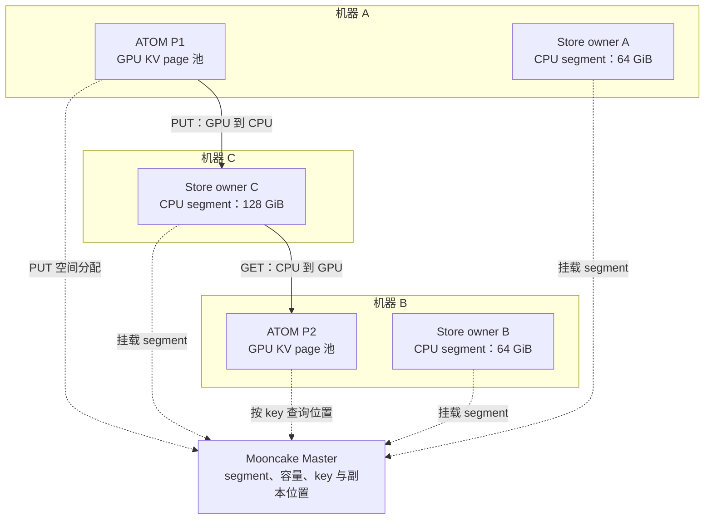
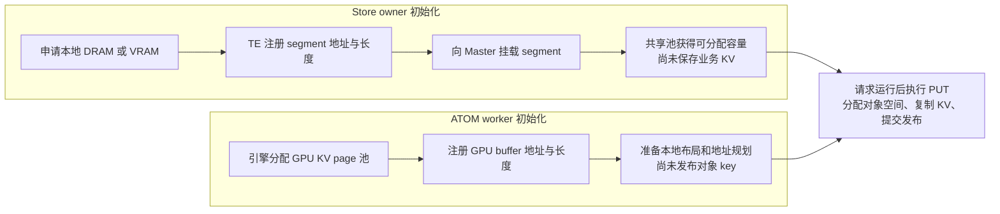
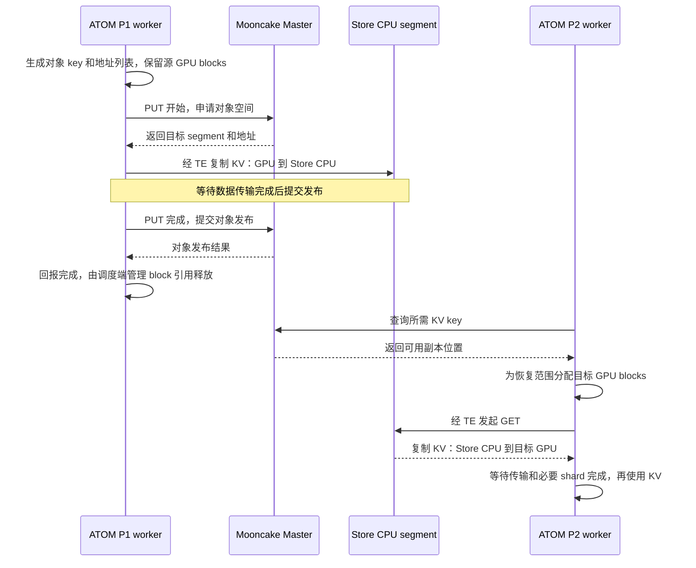
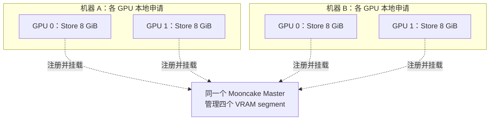
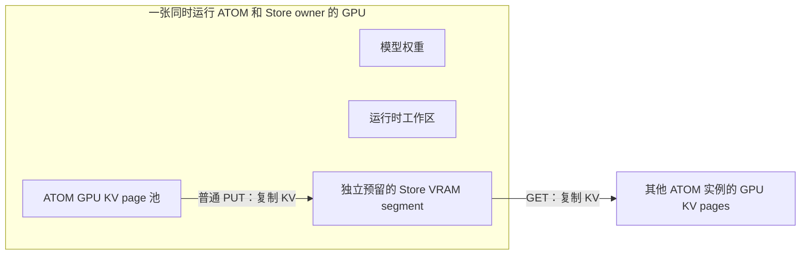
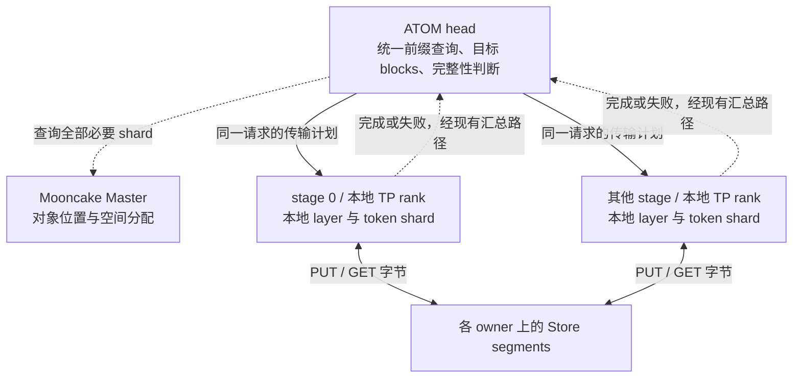
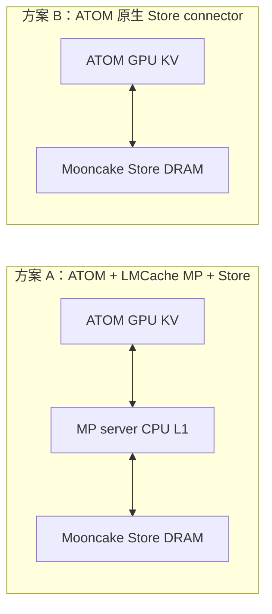
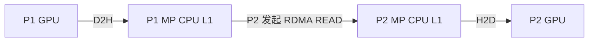

# ATOM KV 共享：LMCache MP 与原生 Mooncake Store 对比

调研日期：2026-09-22。范围是 ATOM 原生引擎的多实例 KV 共享，覆盖 TP、PP/CPP、DCP Prefill 和 DCP Decode。全部服务统一采用选定的接入方案；PP 使用现有 head 统一调度。本文比较两条长期路线，不要求两者混用或缓存互读。

**当前更倾向在 ATOM 内实现原生 Mooncake Store connector，参考本地 vLLM 的实现。** 依据是当前核心需求集中在 ATOM 的共享 KV 池：它可以复用 head 的调度与 stage 完成汇总，并在适合的布局上直接在 GPU 与 Store 间传输，减少额外 CPU 数据路径。LMCache MP 的主要优势是已有 CPU 缓存服务、P2P、多后端与缓存策略，并能用 CPU 缓冲解耦 GPU block 释放和远端写入。如果这些能力是首要需求，MP 更有吸引力。该判断是架构选型，尚无 GPU/RDMA 基准支持性能排名。

阅读入口：[Mooncake Store 详细设计](#mooncake-store-详细设计) 说明多机内存池、数据流和 ATOM 接入职责；[两条数据路径](#两条数据路径) 及后续章节比较原生 connector 与 LMCache MP。

## 比较基线

| 仓库 | 本地版本 | 核对内容 |
|---|---|---|
| ATOM | `af0f76017dcf` | MP adapter、PP head、DCP 布局、完成与内存生命周期 |
| LMCache | `80acf90b1613` | MP GPU/CPU 传输、Store L2、P2P、缓存策略 |
| vLLM | `f92b78f6ef9c` | 原生 Store connector、直接传输、布局、异步查找、GPU block 保留 |
| Mooncake | `78566d459c14` | CPU/VRAM segment 分配、Transfer Engine 注册、Master 挂载与对象发布 |

“vLLM 原生方案”指借鉴其设计，在 ATOM 中实现 connector。它不是把 vLLM connector 类直接装进 ATOM，也不是切换推理引擎。源码能力与实际容器产物、多机验证结果分别看待。

公平比较先采用相同 Mooncake Store 后端、相同 owner 位置、相同网络与缓存容量。MP P2P 是 MP 路线的额外能力，单独评估，不能把它省掉 Store PUT 的收益直接记到 MP + Store 头上。

## Mooncake Store 详细设计

本章作为后续架构讨论的基础。Mooncake 的内存段、注册和对象访问机制来自本地源码；ATOM connector、调度接口和故障处理属于拟接入设计。CPU DRAM 是本文比较和验证的基线；GPU VRAM 的组池方式单独说明，当前没有在 ATOM/ROCm 上完成运行验证。

### 1. 组件职责与内存归属

**多台机器分别贡献内存段，共同组成 Mooncake Store，由同一个 Master 统一管理。** 共享发生在对象访问层：各客户端用 key 访问 KV 对象，物理内存仍属于各自机器和进程。

| 组件或内存 | 负责什么 | 与 KV 数据的关系 |
|---|---|---|
| ATOM GPU KV page 池 | 为 Attention 保存和恢复本地 KV，由引擎管理 page/block | 模型运行实际访问的 KV；PUT 的源和 GET 的目标 |
| Store owner | 持有贡献给 Store 的内存，并维持其生命周期 | 可以在 ATOM worker 内，也可以是独立进程；不要求使用独立机器 |
| Store segment | owner 预留并挂载的对象存储空间 | CPU 方案为 DRAM，GPU 方案为专用 VRAM；普通 PUT 将 KV 复制到这里 |
| Mooncake Master | 管理 segment、容量分配、对象位置和副本元数据 | 大块 KV 留在 owner 的 segment，传输不经 Master 中转 |
| Transfer Engine（TE） | 注册内存并执行本地或跨机数据传输 | 是传输机制；图中的 TE 不代表额外的一份 KV 缓存 |
| SDK 本地 buffer | 为选定 API 或传输操作提供工作空间 | 与贡献给全局 Store 的 segment 分别计费和管理 |

ATOM 的 GPU 物理 page 编号、layer/head/token 布局仍由引擎和 connector 解释。Master 接收对象 key、大小及位置等信息；内存注册不会自动把 ATOM 的 GPU 布局转换成可复用的 KV 对象。

### 2. 多机 CPU 内存如何组成共享池

以下示例中，A、B 同时运行 ATOM 并贡献 CPU 内存，C 只贡献 CPU 内存。实线表示示例中的 KV 数据流，虚线表示注册、分配和查询控制流。



这个共享池的原始容量为 `64 + 64 + 128 = 256 GiB`。图中把对象放到 C 只是一个例子：实际目标由放置策略决定，也可能使用 A 或 B 的 segment。同一个 ATOM 实例既可以读写本机贡献的内存，也可以读写远端贡献的内存。

单副本配置下，256 GiB 是扣除分配开销前的容量上限；若所有对象都保存两个等大的内存副本，则有效数据容量至多约 128 GiB，还要扣除开销。**共享池不会自动在每台机器各保存一份 KV。** Store 副本数量与 P1/P2 引擎中仍保留的 GPU KV 拷贝是两个概念。

CPU segment 的分配和 NUMA 放置发生在各 owner 所在机器上。Master 汇总可用段并安排对象位置，各机器的内存不会因此变成一个可以直接解引用的跨机指针空间。

### 3. 申请内存、注册内存、发布 KV 是三个动作

Store owner 启动时准备可分配空间；ATOM worker 注册自己的 GPU KV buffer；请求产生可缓存的 KV 后，再执行 PUT。这三件事的完成条件不同。



| 动作 | 会不会占用新的容量 | 会不会复制业务 KV | 完成后意味着什么 |
|---|---|---|---|
| owner 申请 segment | 预留新的 Store 容量 | 不会 | owner 持有一块可用于保存对象的内存 |
| TE 注册已有 buffer | 不会新增一份业务 KV；可能有注册资源开销 | 不会 | 传输层知道如何访问这段内存 |
| 向 Master 挂载 segment | 把预留容量纳入共享池 | 不会 | Master 可以在该段安排对象空间 |
| PUT 并成功发布 | 对象占用已有 segment 中的空间 | 会 | 对应对象的可读副本已完成发布 |
| GET 到目标 GPU pages | 使用引擎分配的目标 pages | 会 | 传输完成后，目标 KV 可交给引擎使用 |

源码对应关系：[RealClient 初始化](https://github.com/kvcache-ai/Mooncake/blob/78566d459c140956fd15606e102132b1acc83eec/mooncake-store/src/real_client.cpp) 先分配 segment，再调用 `MountSegment`；[Client 挂载逻辑](https://github.com/kvcache-ai/Mooncake/blob/78566d459c140956fd15606e102132b1acc83eec/mooncake-store/src/client_service.cpp) 先执行 `registerLocalMemory`，再向 Master 挂载地址、大小和端点。[vLLM Store worker](https://github.com/vllm-project/vllm/blob/f92b78f6ef9c9b28f60668da77af5b65645b1a45/vllm/distributed/kv_transfer/kv_connector/v1/mooncake/store/worker.py) 则通过 `register_buffer` 注册引擎 GPU buffer，随后在保存任务中调用 PUT。

### 4. 原生 connector 的 PUT / GET 时序

下图按一个 KV 对象展开，省略批量操作、并发写同一 key 和失败分支。跨 rank 的完整性由 ATOM head 额外汇总，不能把单对象发布成功视为整个前缀已经可恢复。



[Mooncake Client](https://github.com/kvcache-ai/Mooncake/blob/78566d459c140956fd15606e102132b1acc83eec/mooncake-store/src/client_service.cpp) 的 `PutStart`、数据传输、`PutEnd` 对应这一发布顺序，批量路径有相应的开始、传输和完成阶段。Master 返回位置和控制结果；实际数据传输由 TE 完成。

在内存注册、布局和网络均支持时，原生 connector 可以直接以 GPU buffer 作为 PUT 源和 GET 目标。若布局需要 pack/scatter、辅助 index 或转换，仍需保留相应缓冲及设备同步。使用 CPU 作为 Store 介质，并不要求先额外建立一层本地 CPU 热缓存。

GET 是读取和复制，正常 GET 不消费或删除 Store 中的对象。P1 在保存完成后是否仍保留原来的 GPU pages，由其请求和引擎缓存生命周期决定。P2 完成恢复后，在自己的 GPU pages 上执行 Attention。

### 5. 同一份 KV 何时会存在多份

以下以 1 GiB KV、Store 单副本、无额外暂存为例。表中的“存在”描述该时刻的物理数据拷贝，并不代表都要永久保留。

| 时刻 | P1 引擎 GPU | Store CPU | P2 引擎 GPU |
|---|---|---|---|
| P1 已生成 KV，尚未 PUT | 1 GiB | 无此对象 | 无 |
| PUT 成功，P1 pages 仍保留 | 1 GiB | 1 GiB | 无 |
| P2 GET 完成，P1 pages 仍保留 | 1 GiB | 1 GiB | 1 GiB |
| P1 pages 被引擎回收后 | 无 | 1 GiB | 取决于 P2 是否仍保留 |

Store 对象保存在预留 segment 内，占用其中的一部分容量；不是在“预留池之外”再分配一份同样大小的 Store 内存。源 GPU、Store 和目标 GPU 的拷贝拥有不同生命周期。

若 PUT 和 GET 都跨机，1 GiB KV 的两次单副本传输合计约 2 GiB 数据负载，未计协议、重试、辅助数据和副本复制。如果 Store 位于其中一个客户端的本机，相应阶段可能是本地传输，不能把两次数据复制都计作网络流量。

Store 对象被淘汰后，已经 GET 到 P2 的 GPU KV 仍由 P2 管理。反过来，P1 GPU pages 被回收，也不会删除已经成功写入 Store 的独立对象。若 owner 退出且没有其他可用副本，该 owner 上的内存对象会失去可用性；不能把内存 Store 当作持久化备份。

### 6. GPU 作为 Store 介质时如何组池

GPU Store 使用相同的“本地分配 → 注册 → 挂载 → PUT/GET”流程，区别在于 owner 贡献的是 GPU 显存段。一种便于控制设备和容量的组织方式是一张 GPU 对应一个 owner 进程；这是一种部署选择，不是 Store 只允许的进程结构。



这里的原始容量为 `2 台机器 × 每台 2 张 GPU × 每卡 8 GiB = 32 GiB`，实际可保存的 KV 容量还受副本和分配开销影响。每个 owner 需要选择本机 GPU、贡献容量和独立通信端点，并连接同一 Master。当前 VRAM 分配函数读取当前 device 后调用 `cudaMalloc`，没有自动遍历全部机器和 GPU 的逻辑。

若 Store 和 ATOM 共用一张 GPU，显存预算必须同时覆盖模型和 Store：



显存预算为 `模型权重 + 运行时工作区 + ATOM KV page 池 + Store VRAM segment + 其他运行开销`。例如预留 8 GiB 给 Store，就要在 ATOM 可用预算中扣除这部分；同机多个 owner 也需要分别计入。

**GPU Store 的普通 PUT 同样产生独立的 Store 拷贝。** 直接把 ATOM 现有 GPU pages 发布成长期可读对象，还需要页引用、地址稳定性、远端读取和回收协同设计，单独注册 buffer 不具备这一能力。

本地源码的能力边界如下：

- [构建选项](https://github.com/kvcache-ai/Mooncake/blob/78566d459c140956fd15606e102132b1acc83eec/mooncake-common/common.cmake) 中，`USE_VRAM_SEGMENT` 会启用 CUDA；[VRAM 分配代码](https://github.com/kvcache-ai/Mooncake/blob/78566d459c140956fd15606e102132b1acc83eec/mooncake-store/src/client_buffer_allocation.cpp) 使用 `cudaGetDevice` / `cudaMalloc`。
- [RealClient 分配分支](https://github.com/kvcache-ai/Mooncake/blob/78566d459c140956fd15606e102132b1acc83eec/mooncake-store/src/real_client.cpp) 中，RDMA 的 NUMA 分段和大页路径仍可能使用主机内存。因此需要确认实际分配与挂载的内存类型，不能只检查构建开关。
- ATOM/ROCm 接入 GPU Store 时，需要落实 HIP 显存分配、释放和内存类型识别，并验证 TE 的 GPU 注册及跨机 GPU RDMA。GPU buffer 能作为客户端 I/O 源或目标，与 VRAM 能作为 Store segment，是两个需要分别验证的能力。

### 7. 部署与容量配置

Store owner 可以与推理共机，也可以放在专用存储机器。即使共机，也可以用独立 owner 进程持有内存，让它的生命周期独立于 ATOM worker；具体故障可用性仍取决于 owner 是否存活和副本配置。

| 配置或职责 | 含义 | ATOM 部署时需要明确的内容 |
|---|---|---|
| Master 地址 | 所有客户端访问同一个逻辑 Store 管理服务 | 统一集群配置；各节点使用可达地址 |
| `global_segment_size` | 当前 client/owner 贡献的容量 | 按进程累计，避免每个 rank 都重复申请整机预算 |
| `global_segment_size=0` | 该 client 不贡献普通全局内存段 | 可作为只访问共享池的推理 client，owner 在其他进程或机器 |
| `local_buffer_size` | SDK 本地工作 buffer 的容量 | 独立预算；不把它计作全局共享池容量 |
| 本机身份与端点 | 放置策略识别所属主机，传输使用可达端点 | 同机多进程端点不冲突；主机身份与网络端点分别配置 |
| 传输协议与 NIC | 决定数据如何到达目标内存 | 跨机 GPU 直传需要匹配硬件和驱动；NIC 配置不是 GPU 选择 |
| GPU 选择 | 决定 owner 从哪张卡申请 VRAM | 控制进程可见设备或显式选 device；普通 CPU owner 无此要求 |
| key 命名空间与布局身份 | 决定哪些 KV 可以互相恢复 | 统一模型和编码版本，并包含必要的 layer、TP/DCP 等布局信息 |
| 副本与淘汰策略 | 决定有效容量和节点故障下的可用性 | 结合重算成本、热点与故障需求确定，不默认全量复制到所有机器 |

例如单机给 Store 的总 DRAM 预算是 64 GiB，若有 8 个贡献容量的 rank，可各贡献 8 GiB，也可由一个独立 owner 贡献 64 GiB；不能让 8 个 rank 都按“整机 64 GiB”申请。统一接入方案和缓存协议时，各进程的设备、地址及端口仍需按实际部署设置。

[部署文档](https://github.com/kvcache-ai/Mooncake/blob/78566d459c140956fd15606e102132b1acc83eec/docs/source/deployment/mooncake-store-deployment-guide.md) 中，Python `setup` 参数使用 `master_server_addr`、`global_segment_size`、`local_buffer_size`；[独立 client CLI](https://github.com/kvcache-ai/Mooncake/blob/78566d459c140956fd15606e102132b1acc83eec/mooncake-store/src/real_client_main.cpp) 使用 `--master_server_address` 等名称。上表表达配置职责，不应直接当作已验证的 ATOM 启动参数。`P2PHANDSHAKE` 用于 TE 的元数据交换，使用它仍需要 Store Master 管理对象和容量。

### 8. ATOM head、PP/CPP 与 DCP 的接入关系

共享池的物理位置不改变现有 PP 的调度权威：同一 head 下的 stage 使用统一调度和 page table。原生 connector 应让 head 决定可恢复前缀与目标 blocks，各 worker 处理自己实际持有的 layer/token shard。



同一 head 保证调度身份一致；缓存对象仍可能因部分写入、淘汰或故障而不完整。恢复某段前缀前，必须确认所需 layer/token shard 都可恢复；对 GPU blocks 的释放或复用，也要等待所有相关传输进入终止状态。

Store key 和传输计划建议包含模型/编码版本、前缀身份、绝对层范围及 TP/DCP 布局信息，避免相同 token 前缀命中不同物理表示。同构部署先保存 rank-local 表示。DCP Prefill 和 DCP Decode 都纳入接入范围；DCP 使用 TP ranks，不能重复计成 `PP × TP × DCP` 个独立 worker。Decode 新增 KV 的写回边界和跨布局转换仍需单独实现，详见后续 PP/DCP 章节。

### 9. 生命周期与失败处理要求

下面是 ATOM connector 的设计要求，不能仅靠配置一个 Master 地址自动获得。

| 情况 | connector 应保证的行为 |
|---|---|
| PUT 尚未结束 | 保留其可能读取的 GPU blocks，并限制在途字节、队列和 HBM 引用预算 |
| PUT 数据传输或发布失败 | 不把该对象算作已发布；通过 SDK 的失败清理路径处理分配，终止读取后再释放源引用 |
| lookup 命中后 GET 失败 | 将恢复失败交给 head；目标 GPU 写入终止后才能复用 blocks 或回退重算 |
| 只命中部分 stage/rank | 仅把所有必要 shard 都完整的范围计入可复用前缀 |
| 请求取消或超时 | 超时本身不证明 DMA 已停止；需要跟踪传输终止，避免迟到写覆盖新请求 |
| owner 退出或对象被淘汰 | 处理副本不可达或 miss；已有本地 GPU KV 按引擎生命周期继续管理 |
| 正常关闭或重新注册 | 先结束相关传输，再注销/释放 buffer，避免使用已经失效的 GPU 或 CPU 地址 |

GPU source-safe、Store 对象发布成功、全前缀可恢复，是三个不同的完成条件。原生路径可先以保守的 job 完成及全 rank 汇总释放 GPU 引用；后续若希望更早释放，必须有传输层证明源地址不再被读取。

### 10. 后续讨论与验证重点

本章确定了共享池和复制模型；以下参数尚未由源码调研确定，需要结合 ATOM 工作负载讨论和测量。

| 议题 | 当前讨论起点 | 决定依据 |
|---|---|---|
| 存储介质 | 用 DRAM Store 建立比较基线，VRAM 单独验证 | CPU/HBM 预算、GPU RDMA 能力、恢复延迟 |
| owner 放置 | 同机贡献与独立 owner 都可行 | NUMA/NIC 局部性、是否希望缓存跨 worker 重启存活 |
| 对象粒度与命名 | 同构 rank-local KV，覆盖必要 layer/token/index | chunk/page 几何、传输碎片度、全部 shard 的完整性 |
| 容量与副本数 | 显式区分原始容量、有效容量和引擎 KV 拷贝 | 命中率、淘汰、故障重算成本与网络写入量 |
| 异步保存预算 | 为队列与 GPU block 引用设上限 | Store 拥塞时的吞吐、HBM 占用和 p99 TTFT |
| Prefill / Decode 覆盖 | TP、PP/CPP、DCP Prefill、DCP Decode 全部纳入 | 逐项验证 shard 完整性、辅助 index 和 Decode 写回边界 |

验证时应分别记录“共享池命中”“实际搬运字节”“GPU 引用保留时间”和“恢复后输出正确性”。只有查询命中或注册成功，还不能证明 KV 已恢复到可用于执行的状态。

## 两条数据路径

以下路径和成本对比均以 CPU DRAM 作为 Store 介质；GPU Store 的独立显存预算和当前实现边界见上一章。



原生路径的直接传输适用于内存注册、布局和网络后端均支持的情况。不连续数据、辅助 index 或异构转换仍可能需要 pack/scatter 或暂存。Store 的 DRAM 可以位于推理机器，也可以位于独立 owner；大块 KV 不需要经 Master 中转。

A 的实现依据：[ATOM MP backend](../atom/kv_transfer/offload/mp/backend.py) 使用 LMCache 的 `lmcache_driven` 路径，显式拒绝 `engine_driven`；[LMCache worker transfer](https://github.com/LMCache/LMCache/blob/80acf90b1613a49198241a3c4c3ac9f93ec4c2ac/lmcache/v1/multiprocess/transfer_context/worker_transfer.py) 注册设备与事件句柄，由 server 操作 GPU KV；[server 传输代码](https://github.com/LMCache/LMCache/blob/80acf90b1613a49198241a3c4c3ac9f93ec4c2ac/lmcache/v1/multiprocess/modules/lmcache_driven_transfer.py) 完成 D2H/H2D，再由 [native Store L2 adapter](https://github.com/LMCache/LMCache/blob/80acf90b1613a49198241a3c4c3ac9f93ec4c2ac/lmcache/v1/distributed/l2_adapters/mooncake_store_l2_adapter.py) 访问 Store。控制消息经过 MQ，不应理解为 GPU KV 都经 Python 序列化后走消息队列。

B 的实现依据：[vLLM Store worker](https://github.com/vllm-project/vllm/blob/f92b78f6ef9c9b28f60668da77af5b65645b1a45/vllm/distributed/kv_transfer/kv_connector/v1/mooncake/store/worker.py) 的 `register_kv_caches` 注册实际 cache buffer；发送和接收使用 `batch_put_from_multi_buffers`、`batch_get_into_multi_buffers`，地址由 [StoreLayout](https://github.com/vllm-project/vllm/blob/f92b78f6ef9c9b28f60668da77af5b65645b1a45/vllm/distributed/kv_transfer/kv_connector/v1/mooncake/store/data.py) 生成。

## 核心优劣

| 比较项 | LMCache MP + Store | ATOM 原生 Store，参考 vLLM |
|---|---|---|
| 远端命中的数据路径 | Store → MP CPU → GPU；有 CPU 中转与跨进程控制 | 可 Store → GPU；减少中间 CPU 传输，潜在延迟和内存带宽优势 |
| 保存与 GPU 释放 | GPU→CPU 完成后可结束对源 GPU 的读取，远端 PUT 从 CPU 继续 | 异步 PUT 直接读取 GPU，相关 block 要保留到各 rank 完成 |
| CPU 容量 | MP L1 与 Store pool 分别管理；策略决定是否长期保留两份 | 无需额外 MP L1；Store pool 及 SDK/转换所需缓冲仍占 CPU |
| 本地热点 | MP 有独立本地 CPU 缓存和策略，可不访问 Store | Store 本身可用本机 CPU segment；局部性由对象放置及读取策略决定 |
| 网络背压 | CPU 缓冲可吸收一部分远端写入积压，但受 L1 容量限制 | 网络变慢可能延长 GPU block 保留；需保存预算、队列上限与回退 |
| 零散布局 | 可先聚合为 CPU 对象，使后续传输更连续；聚合有成本 | 可使用多 buffer 直接传输；碎片过多会增加描述符及调度开销 |
| 功能扩展 | 已有 P2P、多个 L2 adapter、store/prefetch policy、server 管理 | 聚焦 Store，ATOM 自己维护引擎侧协议和策略；Store 本身也有 SSD 能力 |
| 进程与运维 | 多一层 MP server、GPU IPC、注册/重注册、server 与引擎依赖协调 | client 在 worker 中，Store owner 可独立部署；仍需处理 client 错误和资源清理 |
| PP/DCP 接入 | 当前 ATOM MP adapter 明确拒绝，需要扩展 | 需要新 connector；vLLM 有同构 PP/DCP 的参考机制，仍要适配 ATOM 布局 |
| 维护责任 | LMCache 维护缓存服务；ATOM 维护 adapter、GPU 布局及调度协定 | Mooncake 维护共享池；ATOM 维护 connector、GPU 布局及调度协定 |

直接路径并不自动意味着端到端一定更快。CPU 聚合、计算/I/O 重叠、Store 放置、RDMA 碎片度和 GPU 可回收时间都可能改变结果。MP 的通用性也不自动意味着 ATOM 所需并行方式已经支持。

## 关键取舍一：CPU 副本与 GPU block 保留

MP + Store 默认会在 L1 和 Store 中各保留一份 KV。[DefaultStorePolicy](https://github.com/LMCache/LMCache/blob/80acf90b1613a49198241a3c4c3ac9f93ec4c2ac/lmcache/v1/distributed/storage_controllers/store_policy.py) 在 L2 保存成功后不主动删除 L1 条目；条目仍可由 L1 淘汰策略回收。同文件的 `BufferOnlyStorePolicy` 注册为 `skip_l1`，在 L2 保存成功后删除 L1 条目，让 CPU 空间用于后续传输。该策略仍需要 L1 容量，并不绕过 D2H/H2D。读取后的保留由 prefetch policy 管理，是另一项设置。

```text
MP 默认保留：CPU L1 中的 KV + Store 中的 KV
MP skip_l1： 上传期间 L1 暂存；Store 成功后回收对应 L1 条目
原生 Store：GPU KV → Store；按布局保留必要的 SDK/转换缓冲
```

MP 中，D2H 后记录的设备事件可以证明已结束对源 GPU block 的读取；[StorageManager.finish_write](https://github.com/LMCache/LMCache/blob/80acf90b1613a49198241a3c4c3ac9f93ec4c2ac/lmcache/v1/distributed/storage_manager.py) 提交的是 L1 写入，再由 [StoreController](https://github.com/LMCache/LMCache/blob/80acf90b1613a49198241a3c4c3ac9f93ec4c2ac/lmcache/v1/distributed/storage_controllers/store_controller.py) 根据策略异步发布到 L2。因此必须区分“源 GPU 可以释放”和“远端 Store 已可读”。CPU 缓冲已满或写入失败时，仍需要流控与清理。

vLLM 原生 Store 的 [scheduler](https://github.com/vllm-project/vllm/blob/f92b78f6ef9c9b28f60668da77af5b65645b1a45/vllm/distributed/kv_transfer/kv_connector/v1/mooncake/store/scheduler.py) 为每个 store job 增加 GPU block 引用，等全部 worker 报告后释放。当前 `_reference_save_blocks` 在一般路径会保留该请求的全部相关 block，而不仅是当前 job 的 token 子区间，以允许 worker 从上次成功位置补写。这是需要借鉴正确性、同时测量 HBM 成本的具体实现选择。

所以比较 CPU 容量时，还应同时记录 GPU 上被保存任务保留的字节数及保留时间。不能只凭“少一次 CPU 拷贝”判定系统吞吐。

## 关键取舍二：MP P2P 的额外价值

MP P2P 可以直接复用源节点 L1：



它无需先把该 KV 发布到单独的 Store 对象池。这个收益主要针对 CPU 热缓存已经存在、源节点仍在线的场景。P2 读取后可能再保留一份，因此也不保证全局只有一份副本。

[MP P2P 文档](https://github.com/LMCache/LMCache/blob/80acf90b1613a49198241a3c4c3ac9f93ec4c2ac/docs/source/mp/p2p.rst) 和 [P2PController](https://github.com/LMCache/LMCache/blob/80acf90b1613a49198241a3c4c3ac9f93ec4c2ac/lmcache/v1/multiprocess/modules/p2p_controller.py) 显示：Coordinator 管成员，server 为 peers 创建 L2 adapter；远端 lookup-and-lock 后执行 READ。`mooncake_te` 默认 TCP，RDMA 需配置 `MC_TE_PROTOCOL` 和 `MC_TE_DEVICE`。P2P 不递归读取 peer 的其他存储层。

它的成本是源节点容量/生命周期、热点读压力和 peer 查询规模。当前 [默认 PrefetchPolicy](https://github.com/LMCache/LMCache/blob/80acf90b1613a49198241a3c4c3ac9f93ec4c2ac/lmcache/v1/distributed/storage_controllers/prefetch_policy.py) 选择有命中的最小 adapter index，不能假定已有按 RTT 或负载的最优选源。P2P 和 Store 可以位于 MP 的同一 L2 框架，但查询/保存策略需明确；同时开启不自动得到严格的“先 P2P、再 Store”顺序。

原生 Store 也能让推理机器贡献 CPU DRAM，并由 Master 管对象位置；这是共享池的分布式部署，不等同于 MP peer 协议。若所有 KV 本来就要求进入 Store，MP P2P 的独立优势会变小。若主要需求就是共享现有 CPU 热缓存，它会成为选择 MP 的有力理由。

## PP：两条路线都复用 head

[PP engine](../atom/model_engine/pp_engine_core.py) 由 head 调用 `scheduler.schedule()`，通过 `send_metadata` 向 stages 下发同一个 batch，下游接收执行。[现有 Mooncake PP 路径](../atom/kv_transfer/disaggregation/mooncake/mooncake_connector.py) 明确使用 head 的 page table。两条候选都可以采用相同职责划分：

1. head 计算逻辑前缀、查询必要缓存分片，决定恢复范围和目标 block。
2. 各 stage/rank 执行自己负责的 layer/token shard 传输。
3. 本地 TP 汇总后，各 stage 向 head 回报；head 在全部必要传输终止后推进请求或回退。

这部分可参考已有 [PPKVOutputAggregator](../atom/kv_transfer/disaggregation/pp_kv_aggregator.py)。无需为每个 stage 新建独立的前缀调度器。

同一 head 的调度状态一致，各 shard 在存储中的存在性仍需检查，因为写入完成和淘汰可能分别发生。vLLM 的 `_init_lookup_key_prefixes` 枚举 PP/TP/DCP 必要 key，`lookup` 批量检查；其 head/rank-0 查询数据完整性的模式值得复用。

MP 的额外任务是 stage/rank 注册、读者计数和 server 放置。当前 ATOM 的 worker ID 基于 TP，lookup 读者参数也基于 TP；单个 PP 跨主机时，本机 GPU IPC 不能靠一个远程 server 地址解决，需要按节点部署 server 并让 head 的查询覆盖各分片。这个问题属于传输/缓存服务连接，不改变 head 的调度权威。

## DCP Prefill / Decode：同构共享与异构转换分开

统一配置使同构共享成为首个清晰目标：相同模型、层划分、TP/DCP 及 interleave 下，每个 rank 保存和恢复自己的字节，不必先重排成全局标准布局。

[ATOM DCP 布局](../atom/distributed/dcp_layout.py) 的 token owner 为：

```text
owner = (global_token // interleave) % dcp_size
```

每个 scheduler block 对应的全局 token 范围与单 rank 的物理 page 大小不同。DCP 使用 TP ranks，不能把 worker 数重复算成 PP×TP×DCP。布局身份要包含 DCP size/interleave、层范围、KV/index 格式和复制规则；辅助 index 也必须完整传输。

| 事项 | MP 路线 | 原生 Store 路线 |
|---|---|---|
| 同构 DCP P↔P | 扩展当前拒绝 DCP 的 adapter；修正 chunk/block 几何与 rank 注册 | 按 ATOM rank-local region 生成 Store key 与地址计划；校验全部必要 shard |
| PP/CPP + DCP | 共同 head；增加 stage×实际 TP rank 的服务和对象身份 | 共同 head；组合绝对层范围与 token shard，worker 直接处理本地 region |
| DCP P→DCP D | 共享缓存与现有 P→D 交付各自验证，不由 MP 自动解决 PD 映射 | 同样需要验证；Store connector 不自动改变现有 PD 限制 |
| D 新生成 KV→后续 P | 当前 ATOM MP 共用的 chunk scheduler 保存边界仍受 prompt 限制；需要新增写回 | vLLM 有 `save_decode_cache` 参考，但 ATOM 仍需实现 accepted/computed frontier |
| 不同 DCP/TP/PP 布局互读 | 需要真实的布局转换 | 同样需要真实转换，不能仅替换 key 或 Store 地址 |

本地 vLLM 的 Store worker 已有 DCP geometry、DCP rank key 以及全 shard lookup 逻辑，不能笼统地说它完全不支持 DCP。但其 [异构 Store TP 说明](https://github.com/vllm-project/vllm/blob/f92b78f6ef9c9b28f60668da77af5b65645b1a45/docs/features/mooncake_store_connector_usage.md) 限制为特定 full-attention layout、相同 PP、PCP/DCP 关闭；不能把这个异构 TP 能力推广为任意 DCP 互通。

ATOM 现有 Mooncake PD 在 producer DCP>1 且两端 DCP size 不同时明确报错；non-DCP→DCP 的既有映射有 MLA/token-contiguous 和辅助 index 限制。这些是两条路线共同面对的引擎布局边界。

## 接入任务和成熟度

| 工程项 | LMCache MP | ATOM 原生 Store |
|---|---|---|
| 引擎入口 | 已有 `lmcache_mp` 与 LMCache ATOM adapter | 需要 ATOM scheduler/worker connector，实现 Store client 生命周期 |
| TP/PAGE | 有现成注册、复制、future 与故障恢复基础 | 参考 vLLM 地址规划和 ATOM 已有 transfer regions |
| PP/DCP | 当前硬限制，需扩展；不能只删除校验 | 需适配，但 head 与完成汇总已有基础，无须新建调度体系 |
| 异步 lookup | server 有异步能力；ATOM `_MPLookupClient` 当前同步轮询，仍需适配 scheduler | vLLM 有可选 `lookup_async` 和 pending/retry 协定，可作为参考；不是直接复制 API |
| 保存完成 | 已有设备 event 与 source-safe 完成；需区分 L1 成功和远端发布 | 需实现 store job 身份、GPU 引用、全 rank 完成与队列预算 |
| 状态模型 | 当前 adapter 拒绝 SLOT 等状态字段；需新增模型状态表示 | 原生 byte API 不等于自动支持状态模型；需 PAGE+状态的完整恢复边界 |
| 构建 | MP native 扩展、GPU IPC、Store native L2 与版本配套 | Mooncake Store Python bindings、GPU/RDMA 注册与版本配套 |

MP 当前限制可直接在 [ATOM backend](../atom/kv_transfer/offload/mp/backend.py) 的 `_validate_mp_config`、`_build_cache_views`、`_transfer_mode` 查到。[ATOM MP 测试](../tests/test_lmcache_mp.py) 覆盖了这些拒绝分支与部分生命周期；本次只阅读，没有运行。

MP 的 Store L2 需要 native `lmcache_mooncake` 扩展，见 [构建与配置说明](https://github.com/LMCache/LMCache/blob/80acf90b1613a49198241a3c4c3ac9f93ec4c2ac/docs/source/mp/l2_storage/mooncake_store.rst)。ATOM 的 [release Dockerfile](../docker/atom_release.dockerfile) 当前关闭 `WITH_STORE`，两条使用 Store 的路线都需检查实际镜像产物，已有 TE 不等于已有 Store。

vLLM 的 embedded 模式由各 rank 贡献 CPU pool，standalone-store 则由外部 owner 提供。MP + Store 同样可以把 Store owner 放在独立进程。因此，“存储进程独立、缓存随 owner 存活”不是 MP 独有优势；MP 增加的是独立的本地缓存服务层。具体故障行为还取决于 Store 副本和节点可达性。

## 建议的 ATOM 原生接入边界

采用原生路线时，建议保留三个清晰边界：

- **head/scheduler**：前缀 hash、模型/布局身份、必要 shard 集合、查找预算、目标 block、保存/恢复计划与完整性判断。
- **worker/codec**：本地 KV region、GPU memory registration、地址和长度列表、必要的 pack/scatter、设备事件和 PUT/GET 完成。
- **Mooncake Store**：对象分配、位置、共享内存段、可选 SSD、淘汰和实际数据传输；当前以 DRAM 为基线，VRAM 能力按详细设计章节单独验证。ATOM 不重新实现对象存储系统。

同构布局先保存 rank-local 表示。只有确实需要不同拓扑互读时，再引入带全局 token/layer/head 描述的转换计划。异步保存设定在途字节和 HBM 引用预算；lookup/GET 失败在全部设备写入终止后回退，避免迟到写覆盖重算结果。缓存性能优化不能改变请求计算边界。

## 验证如何做才有比较价值

同一模型、同一请求轨迹、同一网络和 owner 位置下对比。采用两种预算口径：一组固定 Store 容量以隔离路径差异；另一组固定总 CPU 内存（MP L1 + Store + 必要缓冲），比较实际部署效率。结果必须分别标明。

| 场景 | 主要观察 |
|---|---|
| P1 发布后，未见过前缀的 P2 首次复用 | 远端真实命中、恢复 token、KV/index 和输出正确性；排除本地 GPU 命中 |
| 相同 P 重复访问与跨 P 访问 | MP L1 的价值、Store 局部性、H2D/D2H、DRAM/NIC 流量 |
| GPU 紧张、Store 写入限速 | 源 GPU block 保留字节/时间、MP L1 积压、准入停顿和 p99 TTFT |
| 长前缀与不同碎片度 | RDMA 描述符数量、pack/scatter 时间、传输/计算重叠 |
| PP/CPP、DCP P、DCP D | 全 rank 完成、chunk 边界、辅助 index、PD 时延与 Decode ITL |
| 单 shard 缺失、取消、进程/owner 重启 | 不提前释放、不在回退后迟到写、不泄漏缓存锁或反复加载 |

若评估 MP P2P，另设不启用 Store 的同构测试，测源节点热点和节点数量增长，不将其结果冒充 MP + Store 的性能。D 新增 KV 写回和异构布局互读分别验收，不与 prompt KV 命中混记。

## 选型依据

对于当前已确认的统一部署、多 P KV 共享、ATOM 原生调度及 PP/DCP 范围，**原生 Mooncake Store 是当前更倾向的路线**：Store 管共享对象，ATOM 控制本身最清楚的调度与 GPU 布局，数据路径也更直接。需要承担 connector 开发、GPU 引用生命周期和 Store 客户端维护。

**若明确需要长期经营独立 CPU 热缓存、直接 P2P 复用、多存储后端或依赖 CPU 缓冲吸收远端背压，则 MP 更适合。** 它的代价是额外 CPU 数据路径、服务层和 PP/DCP adapter 工作；选择 MP 应基于这些功能收益，而不只基于已有一个 adapter。

本次只做源码核对与设计比较，没有修改引擎、启动服务或运行 GPU/RDMA 基准。性能、故障恢复和模型覆盖均按上述验证范围保留边界。
